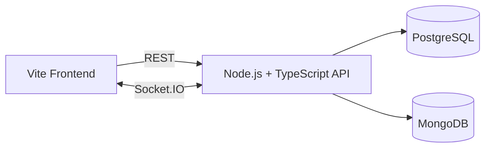
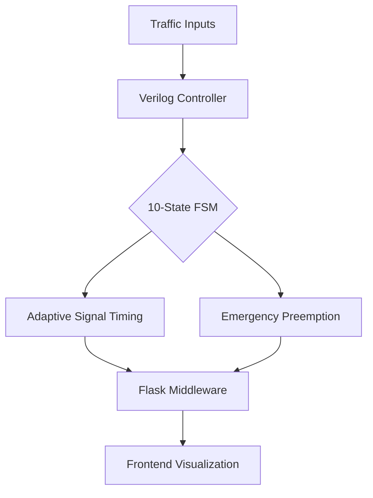
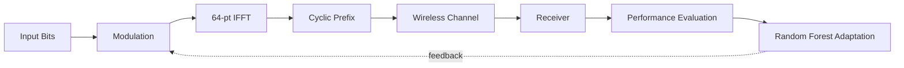

<div align="center">


<a href="https://git.io/typing-svg">

</a>

<br/>

<a href="mailto:ramansingh092005@gmail.com"></a>
<a href="https://www.linkedin.com/in/utkarsh-singh-a07966274/"></a>
<a href="https://github.com/ramansingh092005-arch"></a>
<a href="https://leetcode.com/u/SINGH_UTKAR0402/"></a>
<a href="https://codeforces.com/profile/utkarsh0402"></a>
<a href="https://www.codechef.com/users/mad_coder_09"></a>

<br/><br/>


<br/><br/>

**I enjoy solving complex problems, engineering reliable systems, and turning ideas into working products.**

<br/>

| 🧠 ALGORITHMS | ⚙️ ENGINEERING | 🤖 INTELLIGENCE | 🔌 HARDWARE |
|:---:|:---:|:---:|:---:|
| DSA & Competitive Programming | Backend & Real-Time Systems | AI / Machine Learning | Verilog, FSMs, Digital Comms |

</div>

---

## ⚡ At a Glance

| | |
|:--|:--|
| 🎓 **Education** | B.Tech, Electronics & Communication Engineering, **IIIT Nagpur** |
| 🧠 **Core strength** | Data Structures, Algorithms, complexity analysis |
| ⚙️ **Builds** | Real-time backend systems, hardware simulators, ML-driven systems, algorithm visualizers |
| 🧭 **Approach** | Understand → Find the invariant → Design → Prove correctness → Optimize → Build |
| 🎯 **Looking for** | SDE / Backend internships, Quantitative Engineering opportunities |
| 📬 **Contact** | [ramansingh092005@gmail.com](mailto:ramansingh092005@gmail.com) |

---

## 🚀 Featured Projects

| # | Project | Domain | Core Idea | Stack |
|:-:|:--|:--|:--|:--|
| 01 | **Aaspaas** | Retail Tech | Operating system for kirana shops | `Node.js` `TypeScript` `PostgreSQL` `MongoDB` `Socket.IO` `Vite` |
| 02 | **Smart Traffic Management** | Hardware / Digital Logic | Adaptive signals with emergency preemption | `Verilog` `Icarus` `Python` `Flask` |
| 03 | **Adaptive OFDM System** | AI + Communication | ML-driven modulation adaptation | `MATLAB` `Simulink` `Python` `Random Forest` |
| 04 | **PathFinder** | Algorithms | Interactive graph algorithm visualizer | `React` `JavaScript` `HTML` `CSS` |

<details open>
<summary><b>01 · Aaspaas: Kirana Shop Operating System</b> &nbsp; </summary>

<br/>

> **Vision:** Digitizing neighbourhood retail through one unified shop management platform.

**Problem:** Local shops manage inventory, billing, purchases and customer credit through disconnected manual processes.

**Solution:** A unified operating system for everyday kirana shop operations.

**Key engineering features**

- Shop and product management
- Inventory and stock workflows
- Billing and sales management
- Customer and supplier ledgers
- Purchase and expense tracking
- Real-time updates using Socket.IO

**High-level architecture**



**Roadmap (planned, not yet implemented):** demand forecasting, stock recommendations, natural-language business analytics.

**Stack:** `Node.js` `TypeScript` `PostgreSQL` `MongoDB` `Socket.IO` `Vite`

</details>

<details>
<summary><b>02 · Smart Traffic Management System</b> &nbsp; </summary>

<br/>

> **Vision:** Adaptive traffic control using hardware-oriented digital logic.

**Problem:** Fixed-time traffic signals cannot adapt to changing traffic density or emergency vehicle requirements.

**Solution:** A Verilog-based traffic controller with adaptive signal timing and deterministic emergency prioritization.

**Key engineering features**

- 10-state Finite State Machine
- Dynamic adaptive green timing
- Deterministic emergency preemption
- Hardware-enforced mutual exclusion (no conflicting greens)
- Python Flask middleware
- Frontend traffic visualization

**Architecture**



**Stack:** `Verilog HDL` `Icarus Verilog` `Python` `Flask`

</details>

<details>
<summary><b>03 · AI-Driven Adaptive OFDM Communication System</b> &nbsp; </summary>

<br/>

> **Vision:** Applying machine learning to adaptive digital communication.

**Problem:** Static modulation strategies may not perform optimally as wireless channel conditions change.

**Solution:** An OFDM communication simulation that explores machine-learning-based modulation adaptation.

**Key engineering features**

| Parameter | Value |
|:--|:--|
| IFFT size | 64-point |
| Active subcarriers | 52 |
| Cyclic prefix | 16 samples |
| Channel models | AWGN, Rayleigh |
| Adaptation model | Random Forest |
| Metrics | BER, SER, EVM, Goodput |

**Signal chain**



**Stack:** `MATLAB` `Simulink` `Python` `Random Forest`

</details>

<details>
<summary><b>04 · PathFinder: Graph Algorithm Visualizer</b> &nbsp; </summary>

<br/>

> **Vision:** Making graph algorithms easier to understand through interactive visualization.

| Algorithm | Type | Complexity |
|:--|:--|:--|
| BFS | Unweighted shortest path | O(V + E) |
| DFS | Traversal | O(V + E) |
| Dijkstra | Weighted shortest path | O((V + E) log V) |
| A* Search | Heuristic search | Depends on heuristic |
| Bellman-Ford | Negative edges | O(V · E) |

**Stack:** `React` `JavaScript` `HTML` `CSS`

</details>

<div align="center">

<a href="https://github.com/ramansingh092005-arch?tab=repositories">

</a>

</div>

---

## 🛠️ Tech Stack

<details open>
<summary><b>Explore technologies</b></summary>

<br/>

**Languages**

<p></p>

**Frontend**

<p></p>

**Backend & Databases**

<p></p>

**AI / Machine Learning**

<p></p>

Random Forest · ML fundamentals · Model development and evaluation

**Hardware & Simulation**

<p>


</p>

**Developer Tools**

<p></p>

</details>

---

## 🧠 Competitive Programming

<div align="center">

<a href="https://leetcode.com/u/SINGH_UTKAR0402/"></a>
<a href="https://codeforces.com/profile/utkarsh0402"></a>
<a href="https://www.codechef.com/users/mad_coder_09"></a>

<br/><br/>

<!-- If this card ever fails to load, simply delete this line. -->


</div>

<details>
<summary><b>Topic roadmap and problem-solving loop</b></summary>

<br/>

| Foundation | Intermediate | Advanced |
|:--|:--|:--|
| Arrays, Strings, Hashing | Trees, Graphs, BFS/DFS | Segment Trees, Fenwick Trees |
| Prefix Sum, Sliding Window | Binary Search on Answer | DSU, Shortest Paths |
| Two Pointers, Sorting | Stack, Monotonic Stack, Heaps | Bitmask DP, DP on Trees |
| Recursion, Backtracking | Dynamic Programming, Greedy | Number Theory, Combinatorics |

```cpp
while (!solved) {
    understand_constraints();
    identify_pattern();
    establish_invariant();
    derive_approach();
    prove_correctness();
    analyze_complexity();
    optimize_if_needed();
}
```

</details>

---

## 📊 GitHub Analytics

<div align="center">


</div>

<details>
<summary><b>🐍 Contribution animation</b></summary>

<div align="center">

<picture>
<source media="(prefers-color-scheme: dark)" srcset="https://raw.githubusercontent.com/ramansingh092005-arch/ramansingh092005-arch/output/github-contribution-grid-snake-dark.svg"/>
<source media="(prefers-color-scheme: light)" srcset="https://raw.githubusercontent.com/ramansingh092005-arch/ramansingh092005-arch/output/github-contribution-grid-snake.svg"/>

</picture>

</div>

</details>

---

## 🎯 Roadmap

- [x] Build projects across backend, hardware, ML and algorithms
- [ ] Master Data Structures and Algorithms
- [ ] Improve Codeforces and CodeChef rating consistently
- [ ] Build production-ready backend systems
- [ ] Deepen databases, networking and system design
- [ ] Ship Aaspaas to real shop owners
- [ ] Explore AI and quantitative engineering
- [ ] Contribute to meaningful open-source projects

---

## 🤝 Let's Connect

> 💼 Open to **SDE / Backend internships** and **Quantitative Engineering** opportunities.
> 🤝 Happy to collaborate on products, hackathons and open-source.

<div align="center">

<a href="mailto:ramansingh092005@gmail.com"></a>
<a href="https://www.linkedin.com/in/utkarsh-singh-a07966274/"></a>

<br/><br/>

*"Think in invariants. Build from first principles. Engineer for impact."*


</div>
